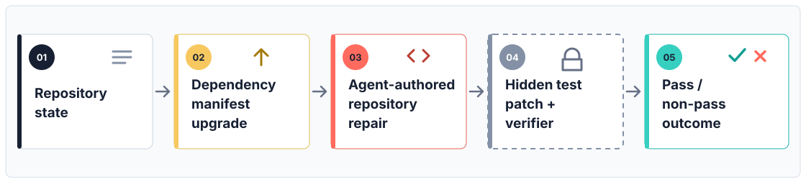

<div align="center">

<picture>
  <source media="(prefers-color-scheme: dark)" srcset="assets/depbench-logo-dark.svg">
  
</picture>

**A repository-level benchmark for dependency-upgrade repair by coding agents**

<p>
  <a href="https://huggingface.co/datasets/ZijiantheJack/DepBench">
    
  </a>
  
  
  
  
</p>

[Quick Start](#quick-start) &middot;
[Benchmark Design](#benchmark-design) &middot;
[Evaluation Protocol](#evaluation-protocol) &middot;
[Artifacts](#release-artifacts) &middot;
[Reproduction](#reproduction) &middot;
[Governance](#project-governance)

</div>

---

DepBench evaluates whether coding agents can repair repository-level breakages
caused by dependency upgrades. Its tasks originate from real merged Dependabot
and Renovate pull requests and span npm/yarn, Maven, Go modules, Cargo, and pip.

This contract-clean release retains **203 valid tasks** from the original
219-task snapshot. Each task separates the dependency upgrade, the developer
repair, and the hidden verifier so that the causal effect of the upgrade can be
checked directly.

> [!IMPORTANT]
> `solution/` and `tests/` are published for reproducibility. Keep both
> directories hidden from agents during evaluation.

## At a glance

| Tasks | Source repositories | Ecosystems |
|---:|---:|---:|
| **203** | **159** | **5** |

## Quick start

Install the release helpers, download the pinned benchmark snapshot from
Hugging Face, and validate the benchmark:

```bash
python3 -m pip install .
python3 repro/download_benchmark.py
python3 repro/validate_release.py
```

The downloader verifies the archive checksum and creates:

```text
dataset/
|-- task_summary.json
`-- tasks/
    `-- <owner>__<repo>__<pull-request>/
```

The Hugging Face revision and archive SHA-256 are pinned in
[`MANIFEST.json`](MANIFEST.json). The downloaded `dataset/` directory is
excluded from Git.

## Benchmark design

<picture>
  <source media="(prefers-color-scheme: dark) and (max-width: 640px)" srcset="assets/benchmark-flow-mobile-dark.svg">
  <source media="(max-width: 640px)" srcset="assets/benchmark-flow-mobile.svg">
  <source media="(prefers-color-scheme: dark)" srcset="assets/benchmark-flow-dark.svg">
  
</picture>

Each task under `dataset/tasks/<task>/` contains:

| Path | Role | Agent visibility |
|---|---|---|
| `instruction.md` | Task prompt | Visible |
| `task.toml` | Docker image, resources, and verifier timeout | Harness |
| `environment/patches/manifest.patch` | Dependency upgrade applied during setup | Hidden |
| `solution/code.patch` | Oracle source repair | Hidden |
| `solution/manifest.patch` | Oracle dependency manifest patch | Hidden |
| `solution/solve.sh` | Oracle application helper | Hidden |
| `tests/test.patch` | Optional held-out test patch | Hidden |
| `tests/test.sh` | Verifier command | Hidden |
| `tests/test_state.py` | Verifier state helper | Hidden |

Some build- or compile-only witnesses do not require `tests/test.patch`.
Task Docker images are referenced from `task.toml` as
`idk233333/depbench-task-images:<task-folder>`.

## Evaluation protocol

1. Select a task from `dataset/task_summary.json`.
2. Start the repository state provided by the task Docker image.
3. Apply `environment/patches/manifest.patch`.
4. Give the agent only the working repository and `instruction.md`.
5. Keep `solution/` and `tests/` unavailable to the agent.
6. Apply `tests/test.patch` when present, then run `tests/test.sh`.
7. Record `1.0` for pass and `0.0` for non-pass. Rows without a valid reward
   remain `no_reward`.

## Release artifacts

| Path | Contents |
|---|---|
| [`analysis/`](analysis/) | Task-contract audits, dependency metadata, repository metadata, and static task classifications |
| [`repro/`](repro/) | Download, validation, image, verifier, Harbor, and benchmark-audit helpers |
| [`custom_agents/`](custom_agents/) | Harbor adapters used by the example configurations |
| [`assets/`](assets/) | DepBench brand assets and responsive benchmark flow diagrams |
| [`MANIFEST.json`](MANIFEST.json) | Machine-readable release and dataset provenance |
| [`THIRD_PARTY_NOTICES.md`](THIRD_PARTY_NOTICES.md) | Third-party data, software, and exceptional-license inventory |
| [`NOTICE.txt`](NOTICE.txt) | Distribution-level third-party notice and attribution pointers |
| [`OPEN_SOURCE_RELEASE_CHECKLIST.md`](OPEN_SOURCE_RELEASE_CHECKLIST.md) | Repository checks and outstanding Microsoft approval steps |

### Audit files

| File | Purpose |
|---|---|
| `analysis/dependency_metadata_corrections_2026-07-26.{md,csv}` | Human-readable and machine-readable audit of 44 corrected package/version metadata rows |
| `analysis/bot_pr_dependency_audit_2026-07-26.{md,csv}` | Cross-check of those 44 rows against merged Dependabot/Renovate PR declarations and final diffs |
| `analysis/instruction_bump_audit_203.{md,csv,json}` | Per-task audit of all 203 final Bump instructions against packaged manifests and upstream PR metadata |
| `analysis/test_patch_behavior_classification_203.csv` | Static held-out test-patch behavior labels and size metrics for the 203 release tasks |
| `analysis/task_change_mechanism_*` | Direct/indirect dependency-upgrade mechanism labels and taxonomy for all 203 tasks |
| `analysis/test_contract_repair_decisions_2026-07-14.{md,csv}` | Contract-audit decisions for the 37 reviewed tasks |

### Repository metadata

`analysis/repository_metadata.{csv,json}` records repository URLs, licenses,
primary languages, archive status, and task counts for the 159 source
repositories. `analysis/task_repository_metadata.csv` provides the corresponding
task-level mapping.

The source repositories use different licenses, including open-source,
source-available, custom, and undeclared terms. Review the license recorded for
each source repository before redistribution or other use.

## Reproduction

Common workflows are available as focused helpers:

| Goal | Command or guide |
|---|---|
| Download the benchmark | `python3 repro/download_benchmark.py` |
| Validate the release | `python3 repro/validate_release.py` |
| Pull all task images | `bash repro/pull_task_images.sh` |
| Verify one oracle solution | `bash repro/run_oracle_solution.sh <task>` |
| Verify a candidate patch | `bash repro/run_patch_verifier.sh <task> <patch>` |
| Run with Harbor | [`repro/HARBOR.md`](repro/HARBOR.md) |
| Read the full reproduction guide | [`repro/README.md`](repro/README.md) |

Harbor configuration templates for every reported configuration are under
[`repro/examples/`](repro/examples/).

## Licensing and third-party content

Microsoft-authored source code, documentation, and DepBench brand assets in
this repository are licensed under the [MIT License](LICENSE.txt). Benchmark
tasks, source excerpts, patches, and other material originating from
third-party repositories are not relicensed under
that MIT license. The MIT license does not grant trademark rights.

The complete source-repository and detected-license mapping is available in
`analysis/repository_metadata.{csv,json}` and
`analysis/task_repository_metadata.csv`. Of the 203 tasks, 192 are classified
as originating from open-source repositories and 11 use source-available,
custom, or undeclared terms. See
[THIRD_PARTY_NOTICES.md](THIRD_PARTY_NOTICES.md) before redistribution or use.

## Data, privacy, and network notice

DepBench-owned helper code does not implement telemetry collection. Commands
in this repository can make outbound requests to Hugging Face, GitHub, Docker
registries, package registries, task-selected dependency sources, and
configured model providers. Third-party tools may have their own telemetry and
privacy behavior.

Authentication values must be supplied at runtime through environment
variables or another approved secret-injection mechanism. Generated example
configs intentionally contain an empty `env` object and must not be committed
after credentials are added.

## Project governance

- Contributions: [CONTRIBUTING.md](CONTRIBUTING.md)
- Security reporting: [SECURITY.md](SECURITY.md)
- Code of Conduct: [CODE_OF_CONDUCT.md](CODE_OF_CONDUCT.md)
- Support: [SUPPORT.md](SUPPORT.md)
- Release review: [OPEN_SOURCE_RELEASE_CHECKLIST.md](OPEN_SOURCE_RELEASE_CHECKLIST.md)

The repository includes technical release preparation, but does not itself
prove completion of Open Source Portal, OSSOM CELA, Open Data, privacy, SDL,
Responsible AI, trademark, or supply-chain approvals.

## Trademarks

This project may contain trademarks or logos for projects, products, or
services. Authorized use of Microsoft trademarks or logos is subject to and
must follow Microsoft’s Trademark & Brand Guidelines. Use of Microsoft
trademarks or logos in modified versions of this project must not cause
confusion or imply Microsoft sponsorship. Any use of third-party trademarks or
logos are subject to those third-party’s policies.

## Release policy

The `main` branch contains reported artifacts and reproduction helpers.
Directory-format benchmark contracts are versioned on
[Hugging Face](https://huggingface.co/datasets/ZijiantheJack/DepBench) and
downloaded on demand. Pin both the Git commit and the Hugging Face revision for
reproducible experiments.
